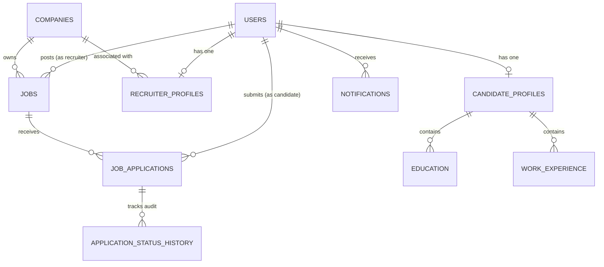

# HireHub – Job Portal & Recruitment Management System

HireHub is a production-style, responsive, full-stack Job Portal and Recruitment Management System engineered with **React (Tailwind CSS)** on the frontend, **Java Spring Boot 3** on the backend, and **PostgreSQL** for relational persistence.

HireHub bridges the gap between ambitious job seekers and enterprise employers through end-to-end recruiter approval workflows, in-app status tracking, role-based security, and cloud deployment readiness.

---

## 1. System Architecture

```
HireHub/
├── frontend/                     # React 18 SPA with Tailwind CSS
│   ├── public/
│   ├── src/
│   │   ├── components/           # Navbar, Sidebar, Footer, Modal, JobCard, etc.
│   │   ├── context/              # AuthContext, NotificationContext
│   │   ├── pages/                # Public, Candidate, Recruiter, Admin portals
│   │   ├── services/             # Fetch API client with Bearer token injection
│   │   └── utils/
│   ├── Dockerfile
│   └── nginx.conf
├── backend/                      # Java 17+, Spring Boot 3.3.4, Spring Security 6
│   ├── src/main/java/com/hirehub/
│   │   ├── config/               # SecurityConfig, CorsConfig, DataInitializer
│   │   ├── controller/           # Auth, Candidate, Recruiter, Job, Application, Admin
│   │   ├── dto/                  # Request & Response transfer objects, validation
│   │   ├── entity/               # JPA entities (User, CandidateProfile, Job, Application...)
│   │   ├── enums/                # Role, JobStatus, ApplicationStatus, NotificationType
│   │   ├── exception/            # Custom exceptions & GlobalExceptionHandler
│   │   ├── mapper/               # EntityDtoMapper
│   │   ├── repository/           # Spring Data JPA repositories with custom queries
│   │   ├── security/             # JwtTokenProvider, JwtFilter, CustomUserDetailsService
│   │   ├── service/              # Service interfaces & layered implementations
│   │   └── HireHubApplication.java
│   ├── src/test/java/com/hirehub/ # Unit and business-logic tests
│   ├── pom.xml
│   └── Dockerfile
├── database/                     # PostgreSQL schema DDL and initial seeds
│   ├── schema.sql
│   └── seed.sql
├── docs/                         # Postman collection & API documentation
│   └── HireHub.postman_collection.json
├── docker-compose.yml            # Multi-container orchestration (App, DB, UI)
└── README.md
```

---

## 2. Technology Stack

### Frontend
- **React.js 18** (Functional components, Hooks, Context API)
- **Tailwind CSS** (Responsive UI, custom brand palette, clean dashboard design)
- **React Router DOM v6** (Nested routes, role-based protected route guards)
- **Fetch API** (Centralized API client with automatic token injection and 401 handling)

### Backend
- **Java 17+** (OpenJDK)
- **Spring Boot 3.3.4**
- **Spring Security 6** (BCrypt encryption, stateless JWT filter pipeline)
- **Spring Data JPA & Hibernate ORM** (Relational mappings, pagination, sorting)
- **Bean Validation** (`@Valid`, `@NotNull`, `@Size`, `@Email`)
- **Maven** (Dependency and build management)

### Database
- **PostgreSQL 15+**
- Strict foreign keys, unique composite constraints (`uk_candidate_job`), and indexing on status, email, and location.

---

## 3. Entity Relationship Diagram



---

## 4. Default Seeded Accounts

The application automatically seeds an administrator and demo accounts for instant evaluation:

| Role | Email | Password | Permissions |
| :--- | :--- | :--- | :--- |
| **Administrator** | `admin@hirehub.com` | `Admin@123456` | Full system audit, recruiter approval, job catalog moderation |
| **Recruiter** | `recruiter@techcorp.com` | `Recruiter@123456` | Approved recruiter for *TechCorp Innovations*, posts jobs, reviews applicants |
| **Candidate** | `candidate@hirehub.com` | `Candidate@123456` | Verified candidate (*Alex Morgan*), profile with education, experience & resume |

> **Tip**: The login page includes one-click demo credentials buttons for instant access to each portal.

---

## 5. Quick Start with Docker Compose

Running the entire stack (React UI, Spring Boot Backend, PostgreSQL DB) requires just one command:

```bash
docker compose up --build
```

- **Frontend**: `http://localhost:3000`
- **Backend API**: `http://localhost:8080/api/v1`
- **PostgreSQL**: `localhost:5432` (`hirehub_db` / `postgres` / `postgrespassword`)

---

## 6. Running Locally for Development

### Prerequisites
- Java 17+ and Maven 3.8+
- Node.js 18+ and npm
- PostgreSQL running locally on port `5432`

### Step 1: PostgreSQL Setup
Create a local database named `hirehub_db`:
```sql
CREATE DATABASE hirehub_db;
```
*(Optional: run `database/schema.sql` and `database/seed.sql` to preload demo data)*

### Step 2: Start Spring Boot Backend
```bash
cd backend
mvn clean spring-boot:run
```
The backend initializes on `http://localhost:8080`.

### Step 3: Start React Frontend
```bash
cd frontend
npm install
npm start
```
The React frontend starts at `http://localhost:3000`.

---

## 7. Key Workflows & Acceptance Criteria

1. **Candidate Lifecycle**:
   - Register account at `/register/candidate`.
   - Update headline, summary, education, and experience at `/candidate/profile`.
   - Upload PDF/DOCX resume (max 10MB) with download verification.
   - Search and filter jobs by keywords, remote/hybrid status, and salary.
   - Submit one-click applications with cover letters.
   - Prevent duplicate submissions to the same role.
   - Withdraw active applications when desired.

2. **Recruiter Lifecycle**:
   - Register at `/register/recruiter`.
   - Account starts in **PENDING** status (`isApproved = false`).
   - Admin approves account via `/admin/recruiters`.
   - Once approved, recruiter publishes jobs via `/recruiter/jobs/new`.
   - Review incoming applicants, download candidate resumes, and advance stages (`UNDER_REVIEW` -> `SHORTLISTED` -> `INTERVIEW` -> `SELECTED` / `REJECTED`).
   - Automatically notify candidates of status updates in real-time.

3. **Administrator Lifecycle**:
   - Secure login (no public registration).
   - Platform dashboard overview with live counts.
   - Review and approve/reject pending recruiters.
   - Remove inappropriate job postings.
   - Audit all global candidate applications and status histories.

---

## 8. Postman Collection

Import `docs/HireHub.postman_collection.json` into Postman to test all endpoints:
- Environment variable `baseUrl`: `http://localhost:8080/api/v1`
- Variable `token`: Populated automatically upon `/auth/login`
- Covers Authentication, Candidates, Recruiters, Jobs, Applications, Admin, and Notifications.

---

## 9. License & Author
Engineered for production full-stack recruitment architecture.
Distributed under the MIT License.
